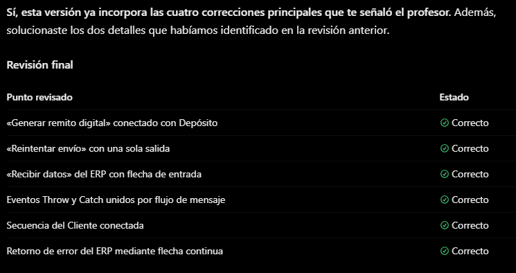
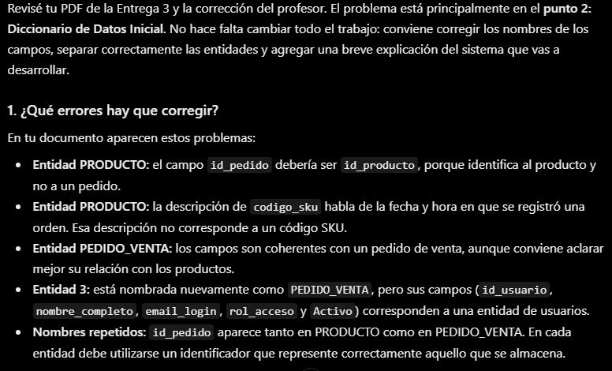
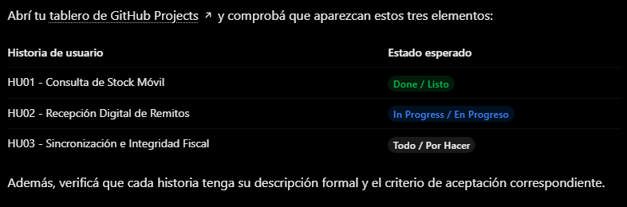

## Evidencia 1: Revisión del diagrama BPMN

**Herramienta utilizada:** ChatGPT.

**Objetivo:** Revisar el diagrama BPMN del sistema I2-Sync, que representa el proceso de venta en ruta, emisión de remitos y sincronización con el ERP local I2.

**Problemas identificados:** Durante la revisión se detectaron actividades sin conexiones adecuadas, un evento de reintento con dos salidas y una actividad del ERP sin flujo de entrada. También fue necesario corregir la representación de los eventos de comunicación con el cliente.

**Intervención humana:** A partir de las observaciones del profesor, se evaluaron las recomendaciones de ChatGPT y se modificó manualmente el diagrama, corrigiendo las conexiones, los flujos de secuencia y los eventos de mensaje.

**Resultado:** Se obtuvo una versión revisada del diagrama BPMN, incorporando las observaciones docentes y respetando la lógica operativa de I2-Sync.

**Captura de la interacción:**

## Evidencia 2: Revisión del diccionario de datos

**Herramienta utilizada:** ChatGPT.

**Objetivo:** Analizar las observaciones del profesor sobre el Diccionario de Datos Inicial de la Entrega 3 del proyecto I2-Sync.

**Problemas identificados:** Durante la revisión asistida por IA se detectaron inconsistencias en la definición de las entidades y sus atributos. Entre ellas, el uso de `id_pedido` como identificador de PRODUCTO, una descripción incorrecta del campo `codigo_sku`, una entidad de usuarios denominada erróneamente PEDIDO_VENTA y nombres de campos que requerían una mejor diferenciación.

**Intervención humana:** Se contrastaron las recomendaciones de ChatGPT con las observaciones del profesor y con la estructura prevista para I2-Sync. Se revisó la correspondencia entre entidades, atributos e identificadores, considerando también las relaciones entre las tablas.

**Resultado:** La revisión permitió identificar las modificaciones necesarias para mejorar la coherencia del diccionario de datos y su correspondencia con el sistema propuesto.

**Captura de la interacción:**

## Evidencia 3: Revisión de historias de usuario en GitHub Projects

**Herramienta utilizada:** ChatGPT.

**Objetivo:** Utilizar inteligencia artificial como apoyo para organizar y verificar las historias de usuario del proyecto I2-Sync mediante GitHub Projects.

**Aspectos revisados:** ChatGPT propuso comprobar que las tres historias de usuario estuvieran registradas en el tablero, con sus respectivos estados: HU01 (Consulta de Stock Móvil) en Listo, HU02 (Recepción Digital de Remitos) en En Progreso y HU03 (Sincronización e Integridad Fiscal) en Por Hacer. También recomendó verificar sus descripciones y criterios de aceptación.

**Intervención humana:** Se utilizó el tablero de GitHub Projects para comprobar la organización de las historias y sus estados, considerando las funcionalidades previstas para I2-Sync. La captura refleja una recomendación de verificación de la IA, no una corrección de un error de diseño.

**Resultado:** La interacción permitió establecer una lista de comprobación para revisar la organización y el seguimiento de las historias de usuario del proyecto.

**Captura de la interacción:**

